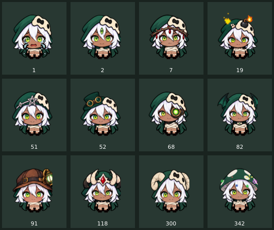

# 里猎手 v1.75-art 动态外观测试版

本版移除v1.73的全部静态配饰贴片，重做66项道具的整合头部造型与表情帧。目标环境：忏悔+及匹配版本的REPENTOGON。

- [下载完整Mod安装包](deliverables/Hunter_v1.75-art_test.zip)
- [浏览美术源图](art_sources) · [制作与验证工具](tools)
- [查看动态哭泣合成预览](deliverables/crying-animation.gif)
- [道具清单](deliverables/COSTUME_CATALOG.md)
- [安装与验证说明](zzzz_revolver_samson/ART_PACK_README.md)

点击ZIP文件后选择Download raw file下载。也可直接使用仓库中的zzzz_revolver_samson文件夹。

## v1.75位置修正

修正启用道具造型后头部向右下方偏移的问题。仅为道具造型切换校正后的头部枢轴，正常人物仍使用原动画；脸部循环效果同步校正。覆盖正面、侧面以及拾取、举物和受伤动作，背面与身体动画保持原坐标。

[查看位置对比](deliverables/alignment-comparison.png)

## 原外观重做

悲伤洋葱替换整张脸的含泪眼睛和张嘴表情，使用三幅独立泪滴帧循环。炸弹引线和蓝蘑菇采用四帧循环。其余道具按参考Mod的处理思路，提供正面/侧面/背面的待机和射击状态，并使用原人物动作曲线。

饰物、头发、脸和兜帽合并绘制，移除旧版悬空配件，按原头顶/下巴边界对齐。拾取、举物、使用道具和受伤动作的头部也使用新造型；动作本身的时序与位移保留。

同槽位采用一种整合造型：悲伤洋葱优先，硫磺火/巴比伦/钉子次之，其余按最近获得显示。此规则避免多张完整脸/帽子穿插，组合不会把所有造型同时叠加。持续型主动依赖游戏临时效果，短时使用反应有单独显示。

EID中英文说明同步，支持巧克力牛奶隐藏替代道具。Stats+数值接口与原玩法保留。调试控制台输入hunterartdiag可查看外观版本和当前造型。

## 安装

完全退出游戏，把旧猎手文件夹移出mods备份，再解压完整安装包，将zzzz_revolver_samson放入mods。只启用一份猎手。不要覆盖解压到旧文件夹，否则旧静态资源可能残留。无需改动EID或Stats+文件。

## 验证

运行 `python3 tools/test_dynamic_art.py`。检查Lua、66项状态/存档逻辑、实际像素不同的动作帧、原生坐标范围、资源引用和真实多帧循环。使用ImageMagick按ANM2坐标离线合成预览。

此云环境没有Isaac运行程序。测试使用接口模拟与离线渲染，尚未进行游戏内验收；不能据此保证全部组合在游戏中显示正确。

## 美术来源与制作

原角色/玩法来自用户上传的猎手v1.72。新整合头部图集由图像生成工具参照原人物制作；图集裁切时仅保留主体，清除相邻帧残片。泪滴、引线与蓝蘑菇循环素材及动画结构借用用户提供的Marisa as Cain v1.16（Cordelia、Vd65_63RUS及其贡献者），并按猎手挂接调整。未打包EID/Stats+本体。

原始图集和循环源文件见art_sources。制作依赖：Python3、Pillow、ImageMagick；运行时模拟检查使用Lua5.4共享库。执行 `python3 tools/build_dynamic_art.py` 装配资源（已存在的头部PNG保留；重新装配前删除hunter_art174中的数字命名PNG）。
